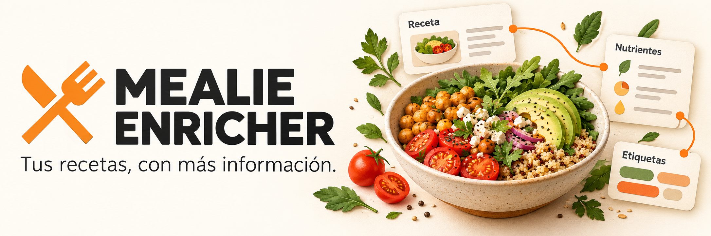

  

<h1 align="center">Mealie Enricher</h1>

  <strong>Your recipes, with more information.</strong> 
  Self-hosted nutrition estimates and automatic tags for your Mealie recipe collection.

  
  
  
  
  

  <strong>English</strong> · <a href="docs/README.es.md">Español</a> · <a href="docs/README.md">Documentación en español</a>

  <a href="#quick-start">Quick start</a> · <a href="#activity-history">Activity history</a> · <a href="docker/README.md">Deployment</a> · <a href="#documentation">Documentation</a> · <a href="CONTRIBUTING.md">Contributing</a>

  

## Give your recipes nutritional context

Mealie Enricher runs alongside [Mealie](https://github.com/mealie-recipes/mealie). It receives recipe events, resolves ingredients, and writes estimated nutrition and automatic tags back to the recipe. A small web interface shows each run and its outcome.

Optional supermarket pricing imports Mercadona into a separate local DuckDB
catalog. It supports a configurable weekly sync, protected manual updates,
Decisions product selection, exact cost-per-serving and purchase tags, and a
product breakdown in recipe extras. Start with postal code `27004`; the feature
is off by default. [Configuration and limitations, in Spanish](docs/20-precios-supermercados.md).

It started as a Python migration of [mealie-calorie-estimator 1.12.3](https://github.com/timo-reymann/mealie-calorie-estimator/tree/c2dc71a1d8effe29375391f2fe50da94d27cfd7d), preserving its HTTP contracts and processing rules. The current release includes optional local **DuckDB/BEDCA catalogs** and **OpenAI Decisions** for ambiguous ingredient matches. The original Open Food Facts path remains available with `CATALOG_ENABLED=false`.

| Feature | What you get |
|---|---|
| **Nutrition per serving** | Estimated calories, macronutrients and other available nutrients. |
| **Automatic Spanish tags** | Calorie and digestibility categories visible in Mealie. |
| **Optional AI** | Fallback for unresolved unit weights or nutrients; optional catalog match selection. |
| **Local food catalogs** | Included BEDCA catalog or your own DuckDB export, separate from runtime data. |
| **Visible activity** | Recipe links, status, changes, duration, nutrients and errors. |
| **Persistent runtime data** | PostgreSQL cache and execution history, with SQLite compatibility. |

## Quick start

You need a running Mealie instance, an API token and Docker with Compose. Images are published for **linux/amd64** and **linux/arm64**:

~~~text
ghcr.io/brunofelixns/mealie-enricher:latest
~~~

Versions are managed automatically from **1.0.0**. Changes enter protected main through passing pull requests. Release Please maintains a version and changelog PR; merging that PR triggers full validation and publication. From **1.2.0**, `latest` and version tags contain one complete image with BEDCA already included. Public images can be pulled without a GitHub account. [CI and release policy](docs/16-github-actions.md).

Download the deployment files:

~~~sh
mkdir mealie-enricher
cd mealie-enricher
curl -fsSL https://raw.githubusercontent.com/brunofelixns/mealie-enricher/main/docker/docker-compose.yml -o docker-compose.yml
curl -fsSL https://raw.githubusercontent.com/brunofelixns/mealie-enricher/main/docker/.env.example -o .env
~~~

In PowerShell, use `curl.exe` for the downloads. You can also download [docker-compose.yml](docker/docker-compose.yml) and [.env.example](docker/.env.example) manually, saving the latter as `.env`.

Edit these values in `.env`:

~~~dotenv
MEALIE_ENRICHER_IMAGE=ghcr.io/brunofelixns/mealie-enricher:latest
MEALIE_URL=https://your-mealie.example.com
MEALIE_API_TOKEN=your-mealie-api-token
POSTGRES_PASSWORD=choose-a-private-database-password
LLM_ENABLED=false
~~~

Start the service:

~~~sh
docker compose config --quiet
docker compose pull
docker compose up -d --no-build --wait --wait-timeout 90
~~~

Open [localhost:8000/estimator/history](http://localhost:8000/estimator/history) to view activity. Configure your Mealie recipe webhook to send events to `http://YOUR-ENRICHER-HOST:8000/webhook`; the event body must include `document_data` as described in the [API contract](docs/03-compatibilidad-y-validacion.md).

`MEALIE_URL` must be reachable from the container, and the webhook must be reachable from Mealie. Inside a container, `localhost` refers to that container. Use a shared Docker network when connecting services by container name.

[Full deployment guide](docker/README.md) · [Guía de despliegue en español](docker/README.es.md)

## Activity history

The web interface at `/estimator/history` lets you:

- Follow recipe processing and open each recipe in Mealie.
- Inspect status, changes, duration, nutrients per serving and errors.
- Filter by event source and state.
- Receive updates every **two seconds**, with light and dark themes.

Compose now includes PostgreSQL for the cache and execution history. History survives
application restarts and has no retention deadline by default. `HISTORY_MAX_ENTRIES=200`
controls the default page size, not the number of stored rows. Set
`HISTORY_RETENTION_DAYS` to a positive number for automatic cleanup of completed
executions. The JSON endpoint supports `since`, `limit` (1–1000) and `offset`.
Unfinished executions become interrupted errors after restart; they are not automatically retried.
Without `DATABASE_URL`, source deployments retain the legacy SQLite cache and
memory-only history (200 entries, 24 hours). Use `DEV_SEED_HISTORY=true` only for
synthetic development activity. [PostgreSQL and backups, in Spanish](docs/19-postgresql.md).

## Automatic tags

The application currently writes automatic tags in **Spanish**, regardless of the README language. Personal tags are preserved.

| Calories per serving | Tag |
|---|---|
| Below 350 kcal | **Calorías:Bajas** |
| 350–600 kcal | **Calorías:Moderadas** |
| Above 600, up to 850 kcal | **Calorías:Altas** |
| Above 850 kcal | **Calorías:Muy altas** |

Digestibility tags are `Digestión:Fácil`, `Digestión:Moderada`, `Digestión:Lenta` and `Digestión:Desconocida`, following the original rules. Legacy English tags are replaced when a recipe is processed again. If its ingredient hash has not changed, existing nutrition is reused and only tags and related extras are updated.

Enable `NOVA_ENABLED=true` to add an estimated processing tag, `NOVA:1` through
`NOVA:4`, using OpenAI Decisions. It reuses `DECISIONS_API_KEY` or `OPENAI_API_KEY`
and the `DECISIONS_*` model, confidence and request limits; catalog match selection
and the fallback LLM can remain disabled. Missing evidence, low confidence or
provider failures produce `NOVA:Desconocida`. This is an application estimate for
the recipe's ingredients, not an official NOVA rating of a mixed dish. Ordinary
home cooking with oil, salt or sugar does not itself raise the processing group.
[Recipe policy, sources and retry behavior](docs/18-clasificacion-nova.md).

[Tags and history, in Spanish](docs/09-etiquetas-y-vista-web.md).

## How it works

~~~mermaid
flowchart LR
    A["Mealie recipe event"] --> B["Per-recipe queue"]
    B --> C["Unit conversion and ingredient resolution"]
    C --> D["Open Food Facts or local DuckDB/BEDCA"]
    C --> E["Optional AI fallback or match selection"]
    D --> F["Python nutrient calculations and tags"]
    E --> F
    F --> G["Update Mealie"]
    G --> H["Activity history"]
~~~

Python performs the nutrient calculations. In catalog mode, Decisions selects food matches and can leave ingredients unresolved when evidence is insufficient. It does not calculate nutrition. The LLM fallback and Decisions are separate, optional settings.

### Included BEDCA catalog

From **1.2.0**, the normal image includes the ready-to-use DuckDB catalog, original
BEDCA CSVs and attribution under `/opt/bedca`. The deployment example enables
`CATALOG_ENABLED=true` and uses `CATALOG_DB_PATH=/opt/bedca/catalogos.duckdb`.
Pull `latest` or a normal version tag; no variant choice, CSV download or import
is needed on the server. [Contents and updates, in Spanish](docs/15-imagen-con-bedca.md).

The included data retain AESAN/BEDCA's non-commercial terms. Existing `bedca`
aliases point to this same image for compatibility. Historical tags through
1.1.0 retain their original contents; new releases do not publish `X.Y.Z-bedca`.

For a custom catalog, use the optional importer and explicitly set
`CATALOG_DB_PATH=/app/catalogs/catalogos.duckdb`; its volume is mounted read-only.
Runtime cache and history use PostgreSQL in Compose. [Custom catalog preparation, in Spanish](docs/11-catalogos-duckdb.md).

## Configuration

The deployment [.env.example](docker/.env.example) lists available settings. The
[root example](.env.example) targets the development Compose and source image
build, including the bundled BEDCA path. For a bare Python process, use host
paths such as `CACHE_DB_PATH=data/cache.db` and `PRICING_DATA_DIR=data/supermarkets`;
disable the catalog or point `CATALOG_DB_PATH` to a prepared host DuckDB file.

| Variable | Purpose |
|---|---|
| `MEALIE_URL` / `MEALIE_API_TOKEN` | Mealie instance and API token. |
| `MEALIE_API_TOKEN_<HOUSEHOLD_ID>` | Optional household-specific token; replace punctuation in the ID with underscores. |
| `LLM_ENABLED` | Enable the optional fallback LLM. |
| `LLM_BASE_URL` / `LLM_ENDPOINT_URL` | Compatible provider URL and endpoint. |
| `LLM_API_KEY` / `LLM_MODEL` | Fallback provider credentials and model. |
| `CATALOG_ENABLED` / `CATALOG_DB_PATH` | Enable a prepared local DuckDB catalog. |
| `DECISIONS_ENABLED` | Enable optional selection of ambiguous catalog matches. |
| `NOVA_ENABLED` | Enable optional NOVA recipe tags through Decisions, independently of catalog matching. |
| `DECISIONS_API_KEY` / `OPENAI_API_KEY` | Decisions credentials; the former takes precedence. |
| `ESTIMATE_STRATEGY` / `ESTIMATE_TAG` | Process all recipes or only those carrying a selected tag. |
| `OFF_LANGUAGE` | Open Food Facts search language. |
| `DATABASE_URL` | SQLAlchemy PostgreSQL URL; Compose sets an internal URL automatically. |
| `POSTGRES_DB` / `POSTGRES_USER` / `POSTGRES_PASSWORD` | Bundled PostgreSQL database and credentials. |
| `HISTORY_RETENTION_DAYS` | Completed history retention; `0` keeps all rows. |
| `CACHE_DB_PATH` | Legacy SQLite cache path when `DATABASE_URL` is empty. |
| `PORT` / `PUBLISHED_PORT` | Container and host port in the deployment Compose. |

Code defaults retain Mistral and German OFF search from the original application. The Compose examples use an OpenAI-compatible endpoint and English OFF search. Configure your provider and language explicitly. The Agents SDK adapter does not require changing providers.

For reasoning models (GPT-5/GPT-6 and o-series), the fallback sends `max_completion_tokens`
and omits `temperature`. Leave `LLM_MAX_TOKENS_GRAMS` and `LLM_MAX_TOKENS_NUTRIENTS`
empty to use model-specific budgets: 1024/2048 tokens for reasoning models, 10/200
for classic models. Explicit values take precedence. When switching an existing
deployment to a reasoning model such as `gpt-6.1-sol`, remove old 10/200 limits
or increase them; these limits also include reasoning tokens. Truncated responses
are discarded instead of being cached as estimates. HTTP failure logs include
the model, provider error code, parameter and request ID when available.

## Incomplete imported ingredients

The enricher automatically recovers missing ingredient fields from `originalText`
inside a temporary estimation view. For example, `100 gramo(s) Quinoa` supplies
an exact mass, while `8 unidad(es) Jamoncitos de pollo` supplies a count whose
food-specific weight can be estimated when `LLM_ENABLED=true` and `LLM_API_KEY`
is configured. The original Mealie ingredients, reference IDs and instructions
are preserved; only nutrition, tags and estimator metadata are patched.

Decimal commas, fractions, Spanish/English unit names and explicit package
weights are supported. Recovered volume requires a food-specific weight estimate.
Packages without a net weight, quantities such as “to taste”, ranges and conflicting
fields remain unresolved and count as unmatched rather than zero. Recovery details
and estimated weights are recorded in `calorie_estimator_ingredient_recovery`.
Existing partial-sum behavior still applies when some ingredients are unresolved.

This does not require Mealie's ingredient parser or its AI provider configuration.
[Recovery behavior and Mealie parser troubleshooting, in Spanish](docs/17-recuperacion-ingredientes.md).

## HTTP API

| Method | Path | Purpose |
|---|---|---|
| GET | `/health` | Service status and UTC timestamp. |
| POST | `/webhook` | Accept a Mealie event containing `document_data`. |
| POST | `/estimate` | Force estimation for `content.slug`. |
| POST | `/backfill` | Process existing recipes in the background. |
| GET | `/estimator/history` | Open the activity interface. |
| GET | `/estimator/history.json` | Read history; accepts `since` in milliseconds. |

Example body for `POST /estimate`:

~~~json
{"content": {"slug": "my-recipe"}}
~~~

Accepted processing requests return **202**. Check the history for the final result.

## Development

Install **Python 3.14** and **uv**, then:

~~~sh
git clone https://github.com/brunofelixns/mealie-enricher.git
cd mealie-enricher
uv sync --locked
cp .env.example .env
~~~

In PowerShell, replace `cp` with `Copy-Item`. Edit `.env`, then run:

~~~sh
uv run --env-file .env python -m mealie_enricher
~~~

For a local Docker build, first prepare the three verified BEDCA CSVs in
`data/bedca` following the [build preparation guide](docs/15-imagen-con-bedca.md#construcción-para-mantenedores).
They are external build inputs, including when catalog use is disabled at runtime.
Then use `docker compose up -d --build calorie-estimator` from the repository root.
Run **one application process**: its queue, recipe locks and rate limiters are in memory.
For source-only PostgreSQL development, set `DATABASE_URL` to your database's URL.

### Checks

~~~sh
uv run ruff check src tests alembic
uv run ruff format --check src tests alembic
uv run mypy src
uv run pytest
~~~

Ordinary tests use synthetic data and mocked transports. Docker integration and real-provider checks are separate, opt-in checks. [Validation evidence and scope, in Spanish](docs/06-resultados-ejecucion.md).

## Limitations

- Nutrition and digestibility values are estimates. The legacy OFF path uses the first match and retains approximations such as ml=g.
- Missing nutrients and LLM-parsed zeros retain legacy behavior outside the catalog path.
- Webhooks and backfill preserve manually entered calories; `POST /estimate` forces recalculation.
- Pending tasks do not survive a restart. PostgreSQL history records interrupted work; run a single instance.
- HTTP routes retain upstream access behavior and do not add authentication. Deploy on a trusted network or behind your authenticated reverse proxy.
- Included BEDCA data retain their own non-commercial terms. Real-provider success is distinct from mocked tests.

## Documentation

**[Leer el README en español](docs/README.es.md)** · **[Índice de documentación en español](docs/README.md)**

| Guide | Language |
|---|---|
| [Image deployment](docker/README.md) / [Despliegue con imagen](docker/README.es.md) | English / Español |
| [Tags and history](docs/09-etiquetas-y-vista-web.md) | Español |
| [Catalogs and BEDCA](docs/11-catalogos-duckdb.md) | Español |
| [Operations and rollback](docs/07-operacion-y-retorno.md) | Español |
| [Architecture](docs/02-arquitectura.md) | Español |
| [Compatibility and API contracts](docs/03-compatibilidad-y-validacion.md) | Español |
| [Validation with real Mealie](docs/13-pruebas-mealie-real.md) | Español |

## Contributing

Bug reports, ingredient-resolution examples, documentation improvements and pull requests are welcome. See [CONTRIBUTING.md](CONTRIBUTING.md). You can open issues in English or Spanish.

## Credits and license

Based on [timo-reymann/mealie-calorie-estimator](https://github.com/timo-reymann/mealie-calorie-estimator), version 1.12.3. This project retains its [GPLv3 license](LICENSE) and [third-party notices](NOTICE).

The Mealie logo belongs to the [Mealie project](https://github.com/mealie-recipes/mealie). This is an independent companion project. [Visual asset sources and attribution](docs/assets/README.md).
