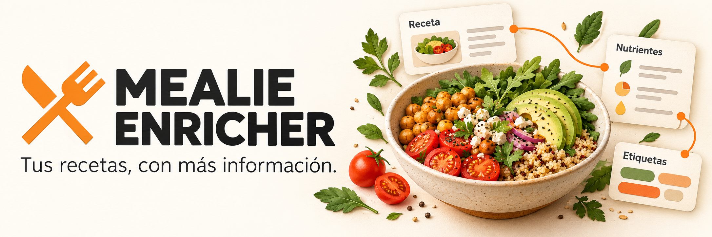

[English](../README.md) | **Español** | [Documentación](README.md)

  

<h1 align="center">Mealie Enricher</h1>

  <strong>Tus recetas, con más información.</strong> 
  Calorías, nutrientes y etiquetas en español para tu recetario Mealie.

  
  
  
  
  

  <a href="#empezar-con-docker">Empezar</a> ·
  <a href="#ver-lo-que-está-pasando">Vista web</a> ·
  <a href="../docker/README.es.md">Despliegue</a> ·
  <a href="README.md">Documentación</a>

  

## Dale contexto nutricional a tus recetas

Mealie Enricher acompaña a tu instalación de [Mealie](https://github.com/mealie-recipes/mealie): recibe sus eventos, consulta los ingredientes y guarda las estimaciones nutricionales y etiquetas en la propia receta. Puedes seguir cada ejecución desde su pequeño historial web.

Es la migración a Python de [mealie-calorie-estimator 1.12.3](https://github.com/timo-reymann/mealie-calorie-estimator/tree/c2dc71a1d8effe29375391f2fe50da94d27cfd7d), con **uv, FastAPI y OpenAI Agents SDK**. Conserva sus reglas y limitaciones, con la adaptación solicitada de etiquetas automáticas al español.

La versión propia **1.0.0** incluye un modo opcional de **catálogos DuckDB + BEDCA** y
**OpenAI Decisions** para resolver coincidencias ambiguas. SQLite se mantiene
exclusivamente para caché. El modo anterior sigue disponible con
`CATALOG_ENABLED=false`.

| | Qué aporta |
|---|---|
| **Estimación por ración** | Calorías, macronutrientes y otros nutrientes disponibles a partir de los ingredientes. |
| **Etiquetas en español** | Clasificación por calorías y digestibilidad, visible en Mealie. |
| **IA opcional** | Fallback para unidades o alimentos que no se resuelven directamente. |
| **Actividad a la vista** | Receta, estado, cambios, duración y errores, con actualización cada dos segundos. |
| **Menos trabajo repetido** | Caché SQLite, hash de ingredientes y agrupación de eventos por receta. |
| **Tu instalación Mealie** | Conexión por API y tokens específicos por hogar cuando los necesites. |

## Empezar con Docker

### Construir y ejecutar desde este repositorio

Necesitas Docker con Compose. Clona el proyecto y prepara la configuración:

~~~sh
git clone https://github.com/brunofelixns/mealie-enricher.git
cd mealie-enricher
cp .env.example .env
~~~

En PowerShell, sustituye el último comando por:

~~~powershell
Copy-Item .env.example .env
~~~

Edita .env antes de arrancar:

~~~dotenv
MEALIE_URL=https://tu-mealie.example.com
MEALIE_API_TOKEN=tu-token-de-mealie
LLM_ENABLED=false
~~~

MEALIE_URL debe ser accesible desde el contenedor. Si Mealie está en otro contenedor y lo conectas por nombre, ambos servicios deben compartir una red Docker.

~~~sh
docker compose config --quiet
docker compose up -d --build calorie-estimator
~~~

Con el puerto por defecto, el historial estará en [localhost:8000/estimator/history](http://localhost:8000/estimator/history).

### Descargar una imagen publicada en GHCR

La carpeta [docker/](../docker/README.es.md) incluye un Compose **sin build** y un [.env.example](../docker/.env.example) independiente. Puedes llevar esos archivos a tu servidor, configurar MEALIE_ENRICHER_IMAGE y ejecutar:

~~~sh
docker compose pull
docker compose up -d --no-build --wait
~~~

**Versión del proyecto:** 1.0.0. Su tag GHCR aún no está publicado. La imagen pública `ghcr.io/brunofelixns/mealie-enricher:latest` sigue apuntando al artefacto anterior con la numeración antigua, disponible para linux/amd64 y linux/arm64. [Evidencia histórica](14-publicacion-open-source.md).

## Catálogo BEDCA local

Prepara los tres CSV externos de BEDCA y conviértelos con:

~~~sh
uv run mealie-catalog import-bedca --input-dir data/bedca --output data/catalogs/catalogos.duckdb --dataset-version 2026-08-19
~~~

Después activa `CATALOG_ENABLED=true`. En Docker, el perfil `catalog-import`
prepara un volumen independiente que la aplicación consulta en solo lectura.
Los datos BEDCA no se incluyen en Git ni en la imagen base. La [variante con
BEDCA incluido](15-imagen-con-bedca.md) conserva DuckDB y los tres CSV originales
y permite arrancar sin importar. Está preparada localmente para uso no comercial,
bajo las condiciones de BEDCA; esta entrega no la publica en GHCR.

El selector respeta estados como crudo/cocido y puede dejar un ingrediente
pendiente cuando falte información. **Decisions selecciona alimentos; Python
calcula los nutrientes.** Las tablas para futuros productos y precios de
supermercados están preparadas, sin datos ni recopiladores todavía.

[Preparación, configuración y actualización del catálogo](11-catalogos-duckdb.md).

## Ver lo que está pasando

Abre el historial con el servicio arrancado:

~~~text
http://DIRECCION-DEL-SERVICIO:8000/estimator/history
~~~

Ahí puedes:

- Seguir cada receta y abrirla directamente en Mealie.
- Consultar estado, cambios aplicados, duración y errores.
- Desplegar los nutrientes estimados por ración.
- Filtrar por origen del evento y estado.
- Recibir actualizaciones cada **dos segundos**, con tema claro y oscuro.

Usa el puerto que hayas publicado. El historial conserva **200 entradas** por defecto durante un máximo de **24 horas** y se pierde al reiniciar.

Para ver datos sintéticos en desarrollo, configura DEV_SEED_HISTORY=true. [Más sobre la vista web y el historial](09-etiquetas-y-vista-web.md).

## Etiquetas que entiendes de un vistazo

| Calorías por ración | Etiqueta en Mealie |
|---|---|
| Menos de 350 kcal | **Calorías:Bajas** |
| De 350 a 600 kcal | **Calorías:Moderadas** |
| Más de 600 y hasta 850 kcal | **Calorías:Altas** |
| Más de 850 kcal | **Calorías:Muy altas** |

La digestibilidad se etiqueta como **Digestión:Fácil**, **Digestión:Moderada**, **Digestión:Lenta** o **Digestión:Desconocida**, siguiendo las reglas del original.

Las etiquetas automáticas inglesas se sustituyen al volver a procesar la receta. Si los ingredientes no han cambiado, se reutiliza la nutrición guardada y se actualizan solo las etiquetas y sus extras. Las etiquetas personales se conservan.

## Cómo funciona

~~~mermaid
flowchart LR
    A["Mealie · evento de receta"] --> B["Cola por receta"]
    B --> C["Conversión y búsqueda"]
    C --> D["Open Food Facts"]
    C --> E["Fallback IA opcional"]
    D --> F["Nutrientes y etiquetas"]
    E --> F
    F --> G["Actualizar Mealie"]
    G --> H["Historial web"]
~~~

El SDK de agentes ejecuta las operaciones LLM existentes con el proveedor, endpoint y modelo configurados. Se conservan los prompts y parámetros; no se añaden herramientas, memoria del agente, delegación, exportación de trazas ni reintentos LLM.

## Configuración

El [.env.example principal](../.env.example) sirve para el desarrollo y la construcción local. El [ejemplo de despliegue](../docker/.env.example) contiene la configuración completa para una imagen descargada.

| Variable | Para qué sirve |
|---|---|
| MEALIE_URL | Dirección de tu instancia Mealie. |
| MEALIE_API_TOKEN | Token con acceso a las recetas. |
| MEALIE_API_TOKEN_&lt;ID_DEL_HOGAR&gt; | Token específico de un hogar; reemplaza signos del ID por guiones bajos. |
| LLM_ENABLED | Activa o desactiva el fallback LLM. |
| LLM_BASE_URL / LLM_ENDPOINT_URL | URL base y endpoint del proveedor compatible. |
| LLM_API_KEY / LLM_MODEL | Credencial y modelo del proveedor elegido. |
| ESTIMATE_STRATEGY | all para todas las recetas o tagged para filtrar. |
| ESTIMATE_TAG | Etiqueta que selecciona recetas cuando la estrategia es tagged. |
| OFF_LANGUAGE | Idioma de búsqueda de Open Food Facts. |
| CACHE_DB_PATH | Ruta de la caché; en Docker, /app/data/cache.db. |
| PORT | Puerto del proceso; 8000 por defecto. |
| PUBLISHED_PORT | Puerto del servidor en el Compose independiente de docker/. |

Los defaults del código conservan Mistral y OFF en alemán. El Compose original usa OpenAI/gpt-4o-mini y OFF en inglés. Los ejemplos reflejan esos contextos; configura explícitamente el proveedor y el idioma que vayas a utilizar. **OpenAI Agents SDK no obliga a cambiar de proveedor.**

[Variables, defaults y contratos completos](03-compatibilidad-y-validacion.md).

## API disponible

| Método | Ruta | Función |
|---|---|---|
| GET | /health | Estado del servicio y fecha UTC. |
| POST | /webhook | Recibir el evento Mealie en document_data. |
| POST | /estimate | Forzar una estimación mediante content.slug. |
| POST | /backfill | Recorrer las recetas existentes en segundo plano. |
| GET | /estimator/history | Abrir la vista de actividad. |
| GET | /estimator/history.json | Consultar el historial; admite since en milisegundos. |

Ejemplo de cuerpo para POST /estimate:

~~~json
{"content": {"slug": "mi-receta"}}
~~~

Las peticiones de procesamiento aceptadas responden **202**; el resultado final se consulta en el historial.

## Desarrollo con uv

Necesitas **uv y Python 3.14**:

~~~sh
uv sync --locked
~~~

Prepara y edita .env como en el arranque Docker; después:

~~~sh
uv run --env-file .env python -m mealie_enricher
~~~

El entrypoint respeta PORT. Ejecuta **un solo proceso**, ya que cola, limitadores e historial viven en memoria.

## Validación

~~~sh
uv run ruff check src tests alembic
uv run ruff format --check src tests alembic
uv run mypy src
uv run pytest --cov=mealie_enricher --cov-report=term-missing
~~~

La validación inicial de la adaptación al español registró **189 pruebas Python y 2 pruebas Docker aprobadas**, con **125 casos de referencia**. La ampliación de catálogos tiene [evidencia de validación adicional](13-pruebas-mealie-real.md). Las ordinarias usan datos sintéticos y transporte simulado, incluido el Runner real del SDK. Docker se comprueba por separado contra Mealie v3.19.2 y OFF local.

[Resultados y alcance de la evidencia](06-resultados-ejecucion.md) · [Plan y pruebas Docker](05-plan-de-implementacion.md).

## Limitaciones conservadas

- Las cifras son estimaciones: OFF utiliza la primera coincidencia y las conversiones mantienen aproximaciones como ml=g.
- Los nutrientes desconocidos y los ceros del parser LLM conservan las reglas originales.
- Webhook y backfill respetan las calorías manuales; POST /estimate fuerza el recálculo.
- Historial, cola y limitadores son locales al proceso. Las tareas pendientes no se recuperan automáticamente tras reiniciar.
- Las rutas y CORS conservan el comportamiento del original.

## Documentación

| Guía | Contenido |
|---|---|
| [Despliegue con imagen](../docker/README.es.md) | Descarga, variables, actualización y volumen persistente. |
| [Etiquetas e historial](09-etiquetas-y-vista-web.md) | Catálogo español, transición de etiquetas antiguas y vista web. |
| [Operación y retorno](07-operacion-y-retorno.md) | Copia de caché y procedimiento de vuelta al original. |
| [Arquitectura](02-arquitectura.md) | Módulos, responsabilidades y capa de IA. |
| [Compatibilidad](03-compatibilidad-y-validacion.md) | Contratos y limitaciones que se mantienen. |
| [Registro completo](README.md) | Decisiones, plan y resultados de la migración. |

## Créditos y licencia

Basado en [timo-reymann/mealie-calorie-estimator](https://github.com/timo-reymann/mealie-calorie-estimator), versión 1.12.3. Se conservan [LICENSE](../LICENSE) y [NOTICE](../NOTICE) de la referencia.

El logo pertenece al proyecto [Mealie](https://github.com/mealie-recipes/mealie). La portada es una ilustración del proyecto; no es una captura de su interfaz. [Origen y atribución de los recursos visuales](assets/README.md).
