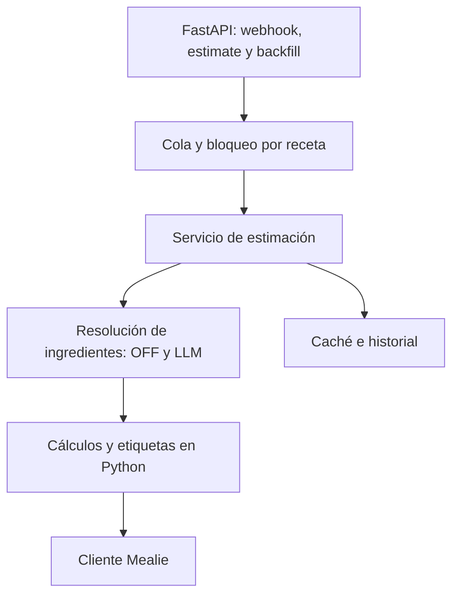

**Sí: uv y FastAPI encajan muy bien.** Para este proyecto recomiendo un **monolito modular asíncrono**, conservando primero el comportamiento original y dejando la IA detrás de una interfaz que permita evolucionarla con PydanticAI.

He revisado el código de `main`, cuyo `package.json` declara la versión **1.12.3**, incluyendo rutas, estimador, clientes externos, caché, cola y pruebas. Es una revisión estática; todavía no he ejecutado ni modificado el proyecto. [Código revisado](https://github.com/timo-reymann/mealie-calorie-estimator/tree/c2dc71a1d8effe29375391f2fe50da94d27cfd7d).

**El original tiene más comportamiento que una llamada a un modelo.** La migración debe conservar:

| Parte actual | Qué debe mantener Python |
|---|---|
| TypeScript + Fastify | Las mismas rutas, cuerpos y respuestas HTTP |
| Webhook de Mealie | Recepción de eventos y agrupación de guardados rápidos |
| Open Food Facts | Búsqueda de nutrientes, idioma, caché y reintentos |
| LLM opcional | Estimación de pesos y nutrientes cuando faltan datos |
| Cálculo nutricional | Totales, raciones, redondeos y campos enviados a Mealie |
| Hash SHA256 | Evitar recalcular cuando los ingredientes no cambian |
| Etiquetas automáticas | Conservar las del usuario y reemplazar las generadas |
| Historial HTML y JSON | Estados, actualización periódica y tema de Mealie |
| Configuración | Variables de entorno y tokens por hogar |

Esto aparece tanto en la [documentación del proyecto](https://github.com/timo-reymann/mealie-calorie-estimator/blob/main/README.md) como en sus servicios.

Hay un detalle importante: **webhook y backfill detectan las calorías manuales; `/estimate` ejecuta directamente la estimación** después de comprobar el filtro de etiquetas. Para que funcione igual, esa diferencia debe quedar cubierta por pruebas. [Webhook](https://github.com/timo-reymann/mealie-calorie-estimator/blob/main/src/routes/webhook.ts), [estimación manual](https://github.com/timo-reymann/mealie-calorie-estimator/blob/main/src/routes/estimate.ts).

**Este es el listado de tecnologías que utilizaría:**

| Área | Tecnología propuesta | Motivo |
|---|---|---|
| Dependencias y entorno | **uv** | Gestionar Python, entorno virtual y dependencias con `uv.lock`; instalación reproducible en Docker y CI |
| API | **FastAPI + Uvicorn** | Sustituir Fastify, mantener los endpoints y disponer de OpenAPI |
| Contratos y validación | **Pydantic v2** | Modelar recetas, ingredientes, nutrientes y respuestas de IA |
| Configuración | **pydantic-settings** | Validar las variables actuales y conservar sus nombres |
| Clientes externos | **HTTPX AsyncClient** | Compartir conexiones, establecer tiempos de espera y consultar Mealie, OFF y el proveedor LLM |
| Persistencia | **SQLite + SQLAlchemy 2.x + Alembic** | Mantener un despliegue sencillo y disponer de migraciones de esquema |
| Concurrencia inicial | **asyncio**, cola y bloqueos por receta | Reproducir la serialización y el debounce actuales |
| Reintentos | **Tenacity** | Centralizar reintentos limitados y esperas progresivas |
| Límites de llamadas | **aiolimiter** | Controlar por separado las consultas a OFF y al LLM |
| Historial web | **Jinja2 + HTML/CSS/JS existente** | Conservar la interfaz, su actualización periódica y el tema |
| Pruebas | **pytest + pytest-asyncio + respx** | Verificar reglas, concurrencia y respuestas simuladas de servicios externos |
| Calidad | **Ruff + mypy** | Formato, análisis estático y comprobación de tipos |
| Despliegue | **Docker Compose** | Mantener la instalación junto a Mealie |

La documentación respalda especialmente el uso de [uv en Docker](https://docs.astral.sh/uv/guides/integration/docker/), [configuración con Pydantic](https://pydantic.dev/docs/validation/latest/concepts/pydantic_settings/), [HTTPX asíncrono](https://www.python-httpx.org/async/) y [SQLAlchemy con asyncio](https://docs.sqlalchemy.org/en/20/orm/extensions/asyncio.html).

SQLite sería mi elección inicial: el original ya guarda su caché en una base SQLite mediante `sql.js`. PostgreSQL tendría sentido si aparecen varios workers o necesidades mayores de concurrencia. [Caché actual](https://github.com/timo-reymann/mealie-calorie-estimator/blob/main/src/utils/cache.ts).

**Para la parte de IA veo cuatro opciones reales:**

| Opción | Ventajas | Coste o limitación | Cuándo la elegiría |
|---|---|---|---|
| **HTTPX + Pydantic, sin framework de agentes** | Control preciso sobre las llamadas actuales y pocas dependencias | Hay que implementar validación, herramientas y seguimiento | **Primera migración con máxima compatibilidad** |
| **PydanticAI** | Salidas tipadas, herramientas, validación y soporte para varios proveedores | Requiere comprobar qué capacidades admite cada proveedor | **Mi recomendación para evolucionar la IA** |
| **LangGraph** | Estado persistente, pasos reanudables y coordinación explícita | Añade más conceptos y configuración | Procesos largos, revisiones humanas o varios especialistas |
| **OpenAI Agents SDK** | Herramientas, delegación, salidas estructuradas y observabilidad | Hay que validar su encaje con el proveedor elegido | Cuando quieras orientar el desarrollo al ecosistema OpenAI |

PydanticAI documenta [salidas estructuradas y validadores](https://pydantic.dev/docs/ai/core-concepts/output/) y [múltiples proveedores](https://ai.pydantic.dev/). LangGraph destaca en [flujos con estado y persistencia](https://docs.langchain.com/oss/python/langgraph/overview). OpenAI explica las capacidades de su SDK en la [documentación de agentes](https://developers.openai.com/api/docs/guides/agents).

**La arquitectura que propongo separa las decisiones de IA de los cálculos y las escrituras.**

Dentro de una sola aplicación organizaría módulos de **estimación, etiquetas, historial e integraciones**, con estas responsabilidades:

- **Servicio de estimación:** decide qué procesar según el evento, los datos manuales y el hash.
- **Resolutores:** buscan nutrientes y resuelven cantidades; aquí se integra la IA.
- **Motor nutricional:** calcula totales, raciones y etiquetas mediante funciones deterministas.
- **Cliente Mealie:** concentra las lecturas y escrituras.
- **Persistencia y ejecución:** administran caché, historial y trabajos.

Si después incorporamos un agente supervisor, le daría herramientas acotadas para buscar alimentos y resolver ambigüedades. **Los totales nutricionales y la decisión final de escribir en Mealie seguirían bajo control del servicio.**

**Estas integraciones las añadiría según la necesidad:**

| Integración | Cuándo aporta valor |
|---|---|
| **Taskiq + Redis Streams** | Para ejecutar trabajos en workers separados y gestionar mensajes pendientes |
| **PostgreSQL** | Para compartir persistencia entre varios procesos |
| **Historial persistente** | Para conservar resultados y errores después de reiniciar |
| **Logfire u OpenTelemetry** | Para observar llamadas, tiempos, errores y consumo de IA |
| **Procedencia de cada dato** | Para distinguir valores obtenidos de OFF, conversiones y estimaciones LLM |

Taskiq dispone de [brokers para Redis y otros sistemas](https://taskiq-python.github.io/available-components/brokers.html). La cola seguiría necesitando idempotencia y bloqueo por receta. En el modo ligero mantendría un único proceso, porque los bloqueos y límites en memoria no se comparten entre procesos.

**Para cumplir “que funcione igual”, la primera entrega debe demostrar equivalencia.** Compararía ambos proyectos con las mismas recetas y respuestas externas grabadas, comprobando:

- Rutas, códigos HTTP y formatos de webhook.
- Hashes, redondeos, raciones y patches enviados a Mealie.
- Protección de datos manuales y conservación de etiquetas.
- Caché, reintentos y eventos simultáneos.
- Estados y respuestas del historial.

También documentaría las aproximaciones actuales: por ejemplo, el conversor trata `ml` como gramos y utiliza pesos fijos para algunas unidades. Cambiar esas reglas o los prompts durante la migración modificaría resultados. [Conversor actual](https://github.com/timo-reymann/mealie-calorie-estimator/blob/main/src/services/unit-converter.ts).

**Mi elección concreta sería uv + FastAPI + Pydantic + HTTPX + SQLite/SQLAlchemy, con arquitectura modular y PydanticAI como evolución de la capa de IA.** Primero verificaría la equivalencia del flujo actual; después incorporaría mejoras de resolución, validación y persistencia de forma explícita.